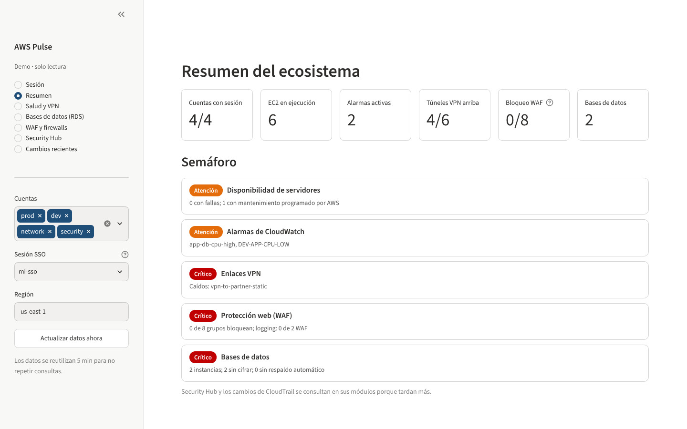
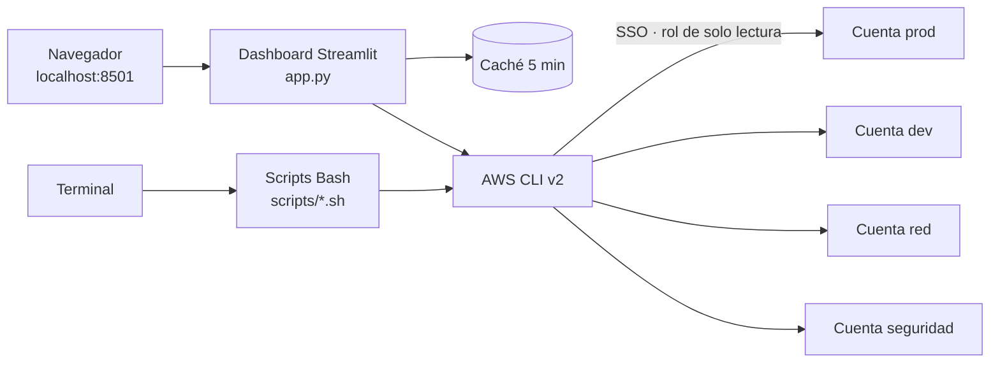
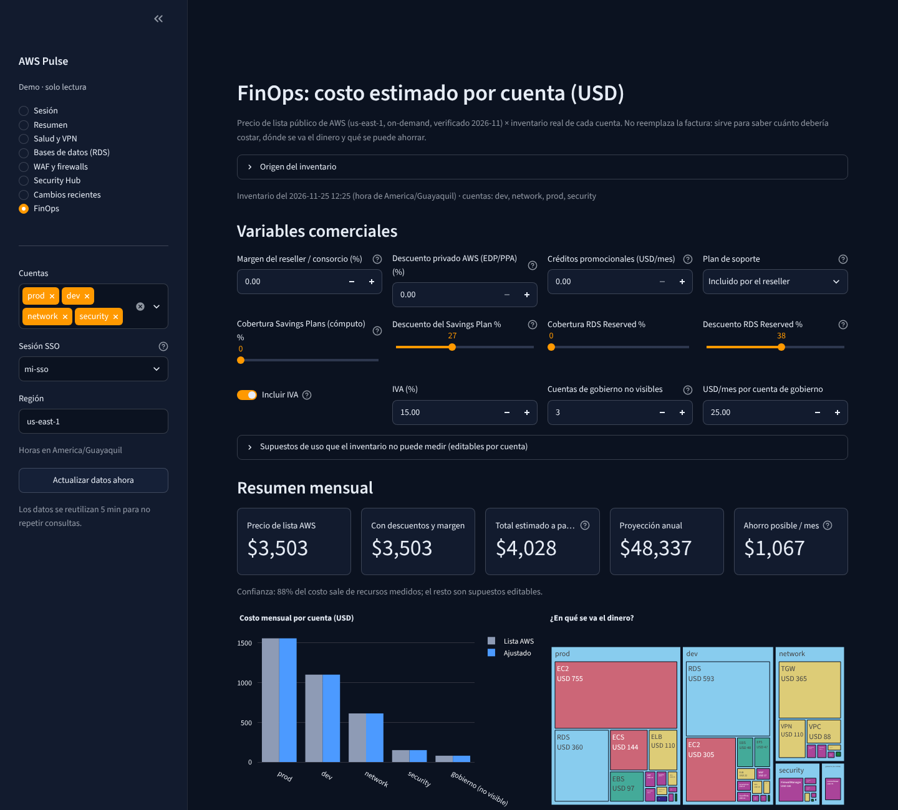
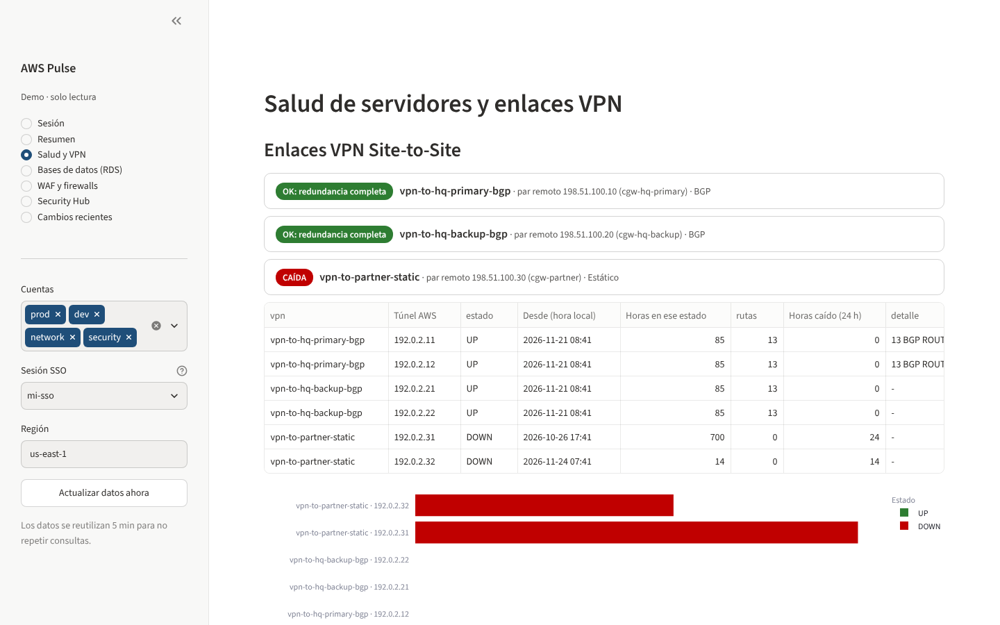
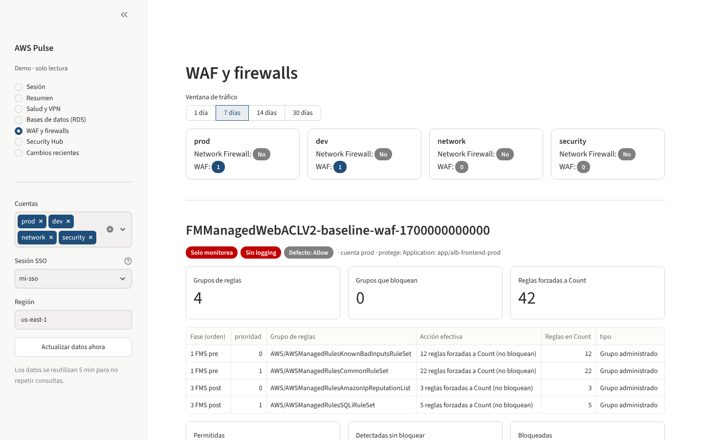
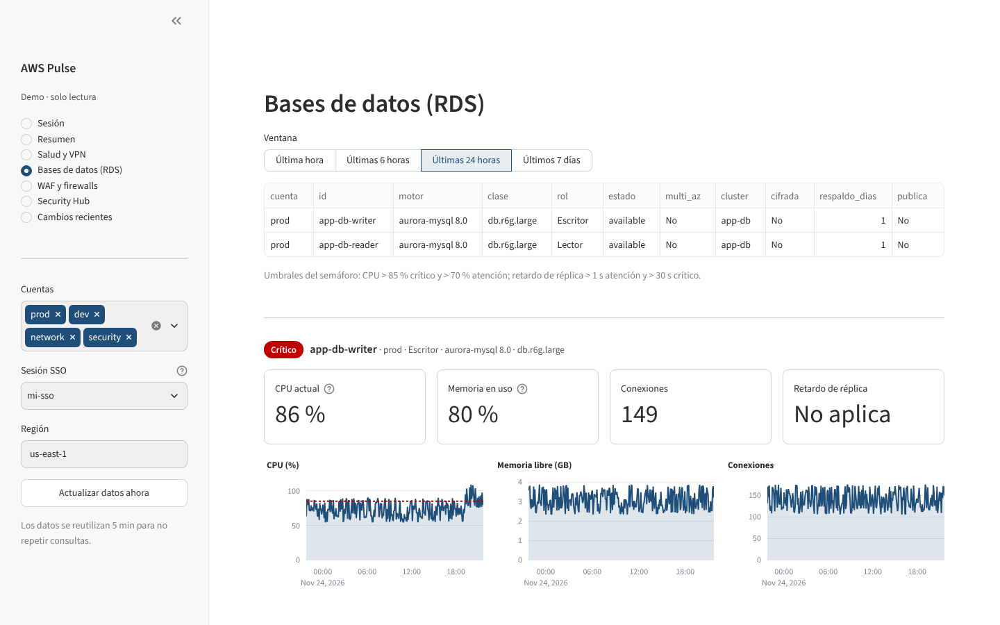
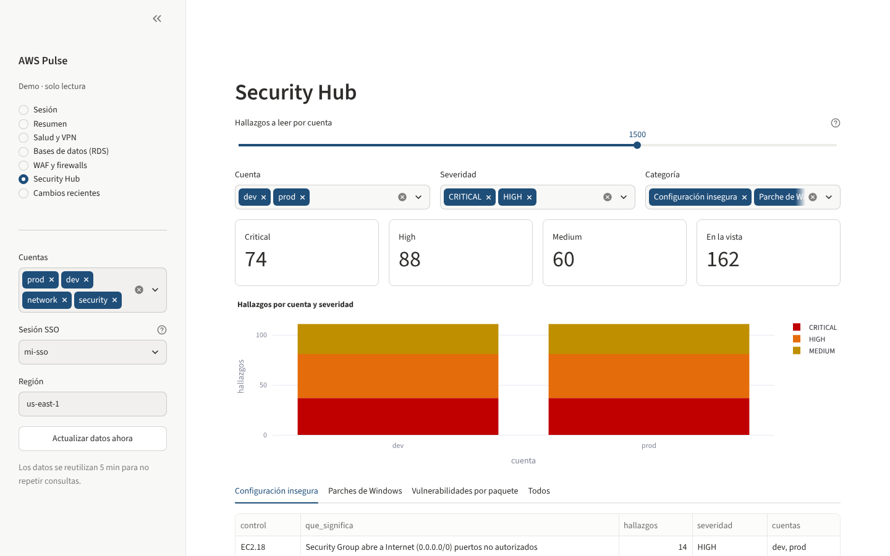

# AWS Pulse: observabilidad y seguridad multicuenta de AWS en un clic

> [English](README.md) · **Español**

> **Read-only, multi-account AWS observability and security posture, from your terminal or a local dashboard.**


Saber en minutos **qué está roto, qué es inseguro y qué cambió** en varias cuentas AWS a la vez, sin entrar cuenta por cuenta a la consola y **sin poder romper nada**: todo funciona con un rol de solo lectura.



---

## Qué resuelve

| Pregunta | Respuesta en AWS Pulse |
|---|---|
| ¿Está todo bien hoy? | Semáforo por área, alarmas, estado de servidores y de cada túnel VPN, con caídas de las últimas 24 h |
| ¿Por qué un servicio no responde? | Pruebas de puertos, VPC Flow Logs y consola del sistema operativo con la hora traducida |
| ¿Mi WAF protege de verdad? | Detecta reglas en modo **Count** (monitorean pero no bloquean), WAF sin logging y recursos sin protección |
| ¿Cómo está la base de datos? | CPU, % de memoria, conexiones y **retardo de réplica** del lector, desde CloudWatch |
| ¿Qué tan segura es la cuenta? | Hallazgos de Security Hub explicados en español: configuración insegura, parches de Windows y CVE por paquete |
| ¿Quién cambió qué? | Línea de tiempo de CloudTrail, con el ruido automático filtrado y los eventos sensibles resaltados |
| ¿Cómo está armada la red? | Mapa de VPC, subredes públicas/privadas, Transit Gateway, VPN, balanceadores y comparación entre cuentas |

## Cómo funciona



- **Sin credenciales nuevas:** reutiliza tu sesión de AWS IAM Identity Center (SSO). Un solo login sirve para todas las cuentas.
- **Sin agentes ni servidores:** corre en tu equipo (Mac, Linux o WSL) y los datos no salen de él.
- **Sin dependencias pesadas:** las consultas usan `aws ... --output json`; no requiere boto3.
- **Consultas en paralelo** a todas las cuentas, con 5 minutos de caché para no repetir llamadas.

## Herramientas y servicios utilizados

| Categoría | Herramientas |
|---|---|
| Acceso | AWS CLI v2, AWS IAM Identity Center (SSO), rol `ReadOnlyAccess` |
| Observabilidad | Amazon CloudWatch (métricas y alarmas), VPC Flow Logs, CloudWatch Logs, consola de EC2 |
| Seguridad | AWS Security Hub, Amazon Inspector, Amazon GuardDuty, AWS Config, AWS CloudTrail |
| Perímetro | AWS WAF, AWS Firewall Manager, AWS Network Firewall, AWS Shield, Route 53 DNS Firewall, Security Groups y NACL |
| Red | Amazon VPC (Shared VPC con AWS RAM), AWS Transit Gateway, AWS Site-to-Site VPN, Elastic Load Balancing |
| Datos | Amazon RDS / Aurora (incluye retardo de réplica) |
| Dashboard | Python, Streamlit, pandas, Plotly |
| Scripts | Bash, awk, `column` (compatibles con macOS, Linux y WSL) |
| Complementarias | Prowler (auditoría CIS / ISO 27001 / NIST), Steampipe (SQL sobre AWS), nmap y netcat |

## Inicio rápido

### Requisitos
- AWS CLI v2 con perfiles SSO configurados en `~/.aws/config`.
- Python 3.10 o superior.
- Un rol con permisos de solo lectura (por ejemplo `ReadOnlyAccess`, opcionalmente con `SecurityAudit`).

### 1. Probar sin AWS (modo demo)
```bash
git clone https://github.com/pablog765/AWS-pulse-observability.git
cd AWS-pulse-observability/dashboard
./iniciar_dashboard.sh --demo        # abre http://localhost:8501 con datos inventados
```

### 2. Usar con tus cuentas
```bash
aws sso login --sso-session <tu-sesion> --use-device-code
export AWS_PULSE_PROFILES="prod dev network security"   # tus perfiles
export AWS_PULSE_ORG="Mi organización"                  # opcional: nombre en la cabecera
cd dashboard && ./iniciar_dashboard.sh
```
La primera vez instala streamlit, pandas y plotly en un entorno aislado (`.venv`), salvo que ya estén instalados en el sistema. En Windows, `iniciar_dashboard.bat` levanta WSL, inicia la app y abre el navegador.

### 3. Scripts de terminal
```bash
cd scripts && chmod +x *.sh
./aws-health-check.sh                 # ¿está todo bien hoy?
./aws-architecture.sh network         # mapa de la red y servicios
DAYS=1 CONSOLE=1 ./aws-changes.sh     # cambios de hoy + consola de cada EC2
./aws-firewalls.sh prod security      # WAF y políticas de Firewall Manager
```
Sin argumentos usan `AWS_PULSE_PROFILES` o, si no existe, todos los perfiles de `~/.aws/config`. Los reportes quedan en `scripts/reportes/`.

## Módulos del dashboard

| Módulo | Contenido |
|---|---|
| **Sesión** | Estado SSO por cuenta y botón de inicio de sesión con código de dispositivo |
| **Resumen** | Indicadores clave y semáforo por área |
| **Salud y VPN** | Túneles VPN (OK / sin redundancia / caída), horas caídas en 24 h, alarmas, mantenimientos, inventario EC2 (IP pública, IMDSv2) |
| **Bases de datos** | CPU, memoria, conexiones y retardo de réplica, con ventanas de 1 h a 7 días |
| **WAF y firewalls** | Acción efectiva por grupo de reglas, reglas forzadas a Count, logging, tráfico diario, reglas que más detectan, Firewall Manager |
| **Security Hub** | Hallazgos por cuenta y severidad, explicaciones en español, enlace a la remediación y exportación a CSV |
| **Cambios recientes** | Línea de tiempo de CloudTrail filtrable por usuario y servicio |
| **FinOps** | Costo mensual estimado por cuenta sin Cost Explorer: inventario × precio de lista de AWS (con enlace a la fuente en cada línea), margen del reseller, descuento privado, Savings Plans / RI, soporte, créditos e IVA; matriz de servicios habilitados, cuentas de gobierno no visibles (Control Tower) y oportunidades de ahorro |



| Salud y VPN | WAF |
|---|---|
|  |  |
| **Bases de datos** | **Security Hub** |
|  |  |

## Scripts de terminal

| Script | Pregunta que responde | Salida |
|---|---|---|
| `aws-health-check.sh` | ¿Está todo bien hoy? | Inventario EC2, alarmas, VPN por túnel, Security Hub traducido, GuardDuty, logins de las últimas 24 h |
| `aws-architecture.sh` | ¿Qué hay y cómo se conecta? | Subredes PÚBLICA / PRIVADA / AISLADA, TGW, VPN, cadena ALB → target group → instancia, RDS, WAF y tabla comparativa entre cuentas |
| `aws-changes.sh` | ¿Qué cambió y qué está pasando? | Cambios de CloudTrail traducidos, eventos sensibles, últimos logs y consola del SO con hora local |
| `aws-firewalls.sh` | ¿Qué protege el perímetro? | Network Firewall, reglas efectivas del WAF (fases pre/cuenta/post de FMS), Shield, DNS Firewall, políticas de Firewall Manager |
| `aws-cost-inventory.sh` | ¿Qué estamos pagando? | Inventario facturable por cuenta (EC2, EBS, RDS, Fargate, VPN, TGW, ELB, IPv4, WAF, FMS, servicios de seguridad) en `reportes/costos/*.tsv`, que lee el módulo FinOps |

Variables de `aws-changes.sh`: `DAYS` (7), `CONSOLE` (0), `LOGTOP` (8), `LOGLINES` (6), `TOPN` (25). Guía completa de comandos en [docs/COMANDOS.md](docs/COMANDOS.md) (inglés: [docs/COMMANDS.md](docs/COMMANDS.md)).

## Seguridad

- **Solo lectura:** ningún comando modifica recursos.
- **Los datos se quedan en tu equipo:** el dashboard no guarda nada en disco y los scripts escriben en `reportes/`, carpeta excluida por `.gitignore`.
- **Nunca subas reportes reales a un repositorio:** contienen IPs, IDs de cuenta y hallazgos de seguridad.
- **Capturas y demo con datos ficticios:** cuentas 111111111111…, IPs de documentación (RFC 5737).

## Compartir el dashboard en la red

Por defecto solo lo abre el equipo anfitrión. Quien entra desde la red necesita contraseña y no ve la página de inicio de sesión SSO:

```bash
export AWS_PULSE_PASSWORD='una-frase-larga'
./iniciar_dashboard.sh          # escucha en 0.0.0.0:8501
```

En WSL 2 además hay que activar la red en modo espejo y abrir el puerto: ver [docs/NETWORK_ACCESS.md](docs/NETWORK_ACCESS.md). Las horas se muestran en `AWS_PULSE_TZ` (por defecto `America/Guayaquil`). La simulación QA de FinOps parte de la cuenta `AWS_PULSE_QA_BASE` (por defecto, la más cara).

## Costos

Las consultas de inventario y configuración no tienen costo por llamada. Solo las métricas de CloudWatch pedidas con `GetMetricData` se cobran (del orden de USD 0,01 por cada 1.000 métricas): recorrer todo el dashboard pide unas 75 métricas. El costo se carga a la cuenta consultada.

## Hoja de ruta

- [ ] Histórico local (SQLite) con gráficos de tendencia: caídas de VPN, hallazgos críticos, CPU de RDS
- [x] Tema claro corporativo y zona horaria local
- [x] Módulo FinOps (costo estimado por cuenta)
- [ ] Alertas por correo o Teams cuando un indicador pasa a crítico
- [ ] Exportar el resumen a PDF
- [ ] Más servicios: ECS, Lambda, API Gateway, costos (Cost Explorer)

## Estructura

```
aws-pulse-observability/
├── dashboard/
│   ├── app.py                  # interfaz: páginas, semáforos y gráficos
│   ├── awsdata.py              # consultas a AWS y traducciones al español
│   ├── iniciar_dashboard.sh    # lanzador Mac / Linux / WSL (--demo)
│   ├── iniciar_dashboard.bat   # lanzador Windows: levanta WSL y abre el navegador
│   ├── requirements.txt
│   ├── .streamlit/config.toml  # tema y puerto
│   └── demo/                   # AWS CLI simulado con datos ficticios
├── scripts/                    # aws-health-check, aws-architecture, aws-changes, aws-firewalls
└── docs/
    ├── COMANDOS.md             # conexión, comandos clave y errores frecuentes
    └── img/                    # capturas (modo demo)
```

## Origen

Nació del diagnóstico de un servicio que no respondía en un entorno AWS multicuenta con red centralizada (Shared VPC y Transit Gateway). Lo que empezó como una prueba de puertos terminó en un kit para revisar salud, red, perímetro y postura de seguridad de todo el ecosistema con un rol de solo lectura. Desarrollado con el apoyo de Claude (Anthropic).

## Autor

**Pablo Guachamin**, Senior Network & Cloud Security Engineer (Quito, Ecuador).

Licencia [MIT](LICENSE).
