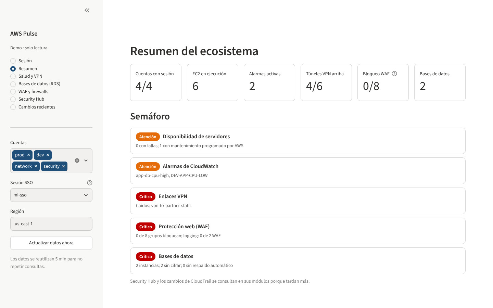
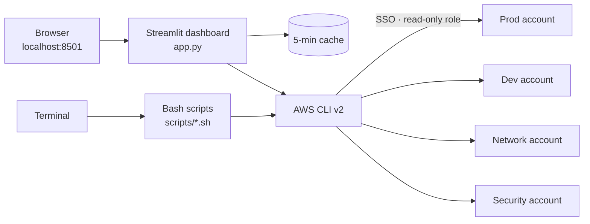
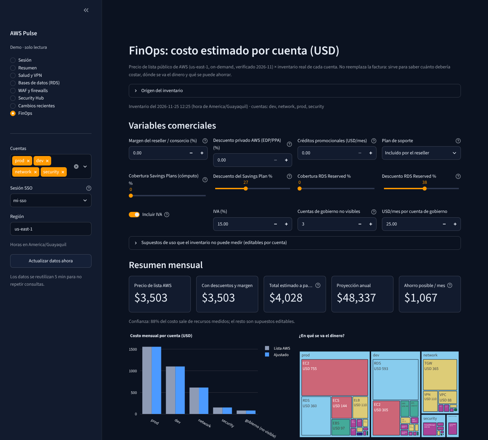
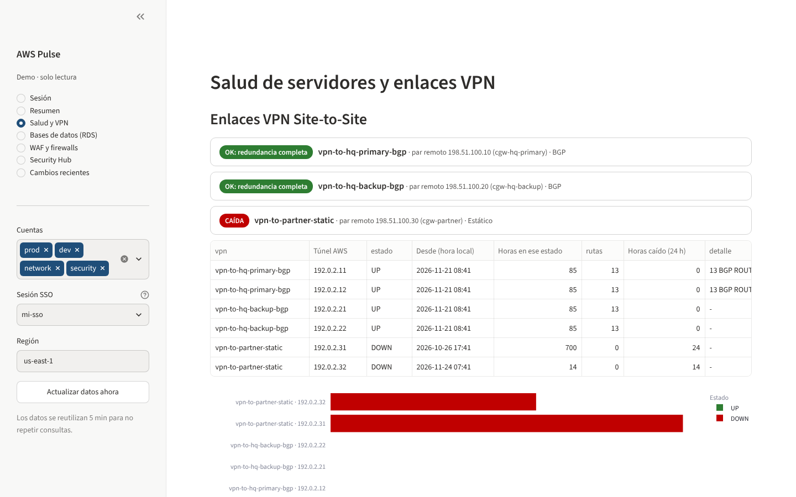
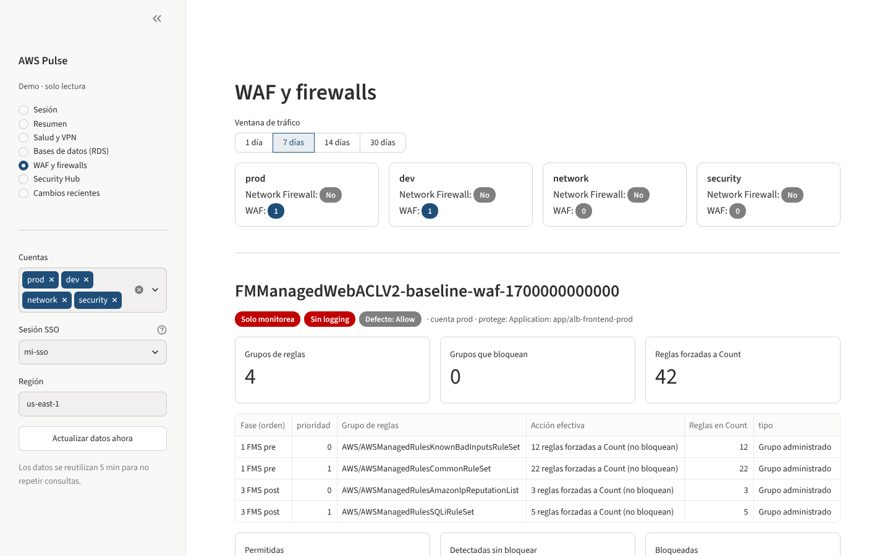
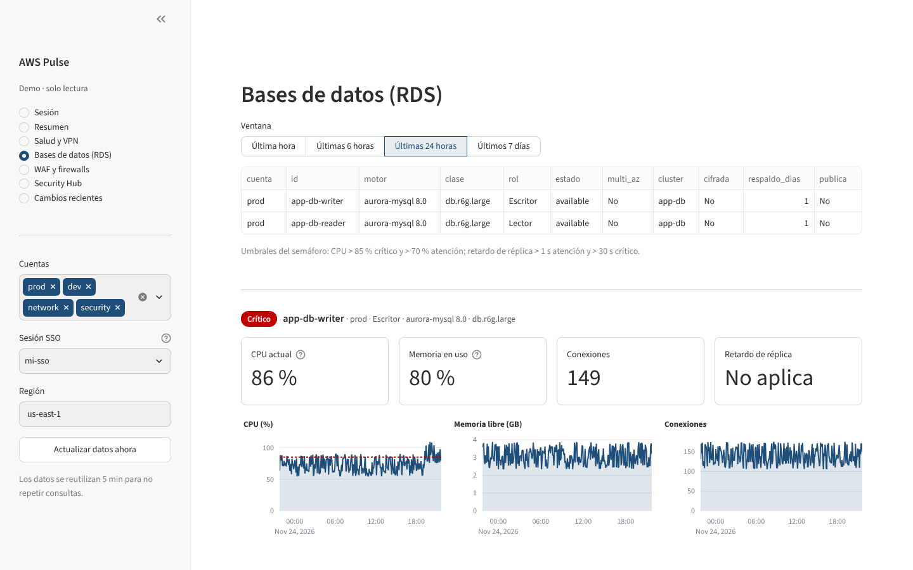
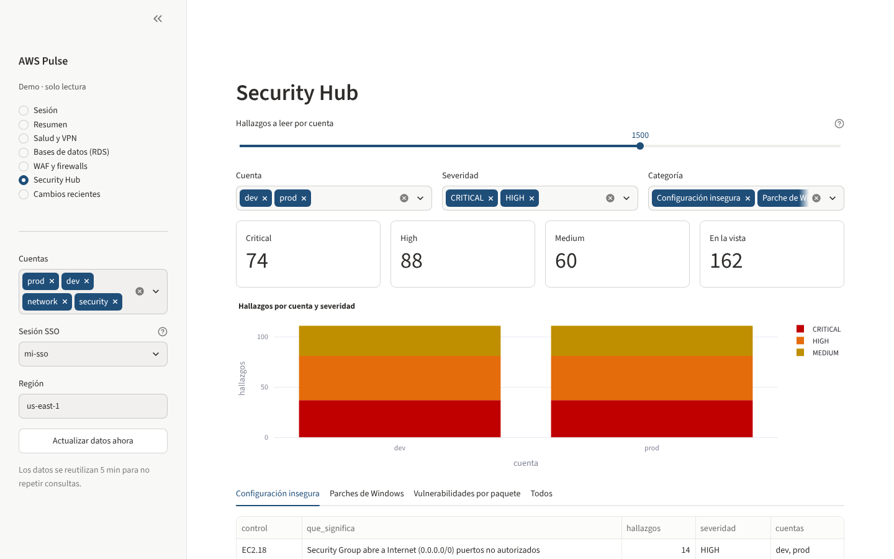

# AWS Pulse: one-click, multi-account AWS observability and security posture

> **English** · [Español](README.es.md)


Find out in minutes **what is broken, what is insecure and what changed** across several AWS accounts at once, without clicking through the console account by account and **without being able to break anything**: everything runs with a read-only role.



> The dashboard UI and the script reports are in Spanish; the code, configuration and documentation are available in both languages.

---

## What it solves

| Question | What AWS Pulse shows |
|---|---|
| Is everything OK today? | Traffic-light status per area, alarms, instance health and every VPN tunnel, including downtime in the last 24 h |
| Why is a service not responding? | Port tests, VPC Flow Logs and the operating system console with translated timestamps |
| Is my WAF actually protecting anything? | Flags rules in **Count** mode (they monitor but do not block), WAFs without logging and unprotected resources |
| How is the database doing? | CPU, memory usage, connections and the reader's **replica lag**, from CloudWatch |
| How secure is the account? | Security Hub findings explained in plain language: insecure configuration, missing Windows patches and CVEs by package |
| Who changed what? | CloudTrail timeline with automated noise filtered out and sensitive events highlighted |
| How is the network built? | Map of VPCs, public/private subnets, Transit Gateway, VPNs, load balancers and a side-by-side comparison of accounts |

## How it works



- **No new credentials:** it reuses your AWS IAM Identity Center (SSO) session. One login covers every account.
- **No agents, no servers:** it runs on your machine (macOS, Linux or WSL) and the data never leaves it.
- **Lightweight:** queries use `aws ... --output json`; no boto3 required.
- **Parallel queries** across all accounts, with a 5-minute cache to avoid repeated calls.

## Tools and AWS services

| Category | Tools |
|---|---|
| Access | AWS CLI v2, AWS IAM Identity Center (SSO), `ReadOnlyAccess` role |
| Observability | Amazon CloudWatch (metrics and alarms), VPC Flow Logs, CloudWatch Logs, EC2 console output |
| Security | AWS Security Hub, Amazon Inspector, Amazon GuardDuty, AWS Config, AWS CloudTrail |
| Perimeter | AWS WAF, AWS Firewall Manager, AWS Network Firewall, AWS Shield, Route 53 DNS Firewall, Security Groups and NACLs |
| Network | Amazon VPC (Shared VPC with AWS RAM), AWS Transit Gateway, AWS Site-to-Site VPN, Elastic Load Balancing |
| Data | Amazon RDS / Aurora (including replica lag) |
| Dashboard | Python, Streamlit, pandas, Plotly |
| Scripts | Bash, awk, `column` (macOS, Linux and WSL compatible) |
| Companion tools | Prowler (CIS / ISO 27001 / NIST audit), Steampipe (SQL over AWS), nmap and netcat |

## Quick start

### Requirements
- AWS CLI v2 with SSO profiles configured in `~/.aws/config`.
- Python 3.10 or later.
- A read-only role (for example `ReadOnlyAccess`, optionally plus `SecurityAudit`).

### 1. Try it without AWS (demo mode)
```bash
git clone https://github.com/pablog765/AWS-pulse-observability.git
cd AWS-pulse-observability/dashboard
./iniciar_dashboard.sh --demo        # opens http://localhost:8501 with made-up data
```

### 2. Use it with your accounts
```bash
aws sso login --sso-session <your-session> --use-device-code
export AWS_PULSE_PROFILES="prod dev network security"   # your profiles
export AWS_PULSE_ORG="My organization"                  # optional: name shown in the header
cd dashboard && ./iniciar_dashboard.sh
```
On first run it installs streamlit, pandas and plotly into an isolated environment (`.venv`), unless they are already installed system-wide. On Windows, `iniciar_dashboard.bat` starts WSL, launches the app and opens the browser.

### 3. Terminal scripts
```bash
cd scripts && chmod +x *.sh
./aws-health-check.sh                 # is everything OK today?
./aws-architecture.sh network         # network and services map
DAYS=1 CONSOLE=1 ./aws-changes.sh     # today's changes + each EC2 console
./aws-firewalls.sh prod security      # WAF and Firewall Manager policies
```
Without arguments they use `AWS_PULSE_PROFILES` or, if it is not set, every profile in `~/.aws/config`. Reports are written to `scripts/reportes/`.

## Dashboard modules

| Module | Content |
|---|---|
| **Session** | SSO status per account and a sign-in button using the device code flow |
| **Summary** | Key indicators and a traffic-light status per area |
| **Health & VPN** | VPN tunnels (OK / no redundancy / down), hours down in the last 24 h, alarms, scheduled maintenance, EC2 inventory (public IP, IMDSv2) |
| **Databases** | CPU, memory, connections and replica lag, with windows from 1 hour to 7 days |
| **WAF & firewalls** | Effective action per rule group, rules forced to Count, logging, daily traffic, top-matching rules, Firewall Manager |
| **Security Hub** | Findings by account and severity, plain-language explanations, remediation links and CSV export |
| **Recent changes** | CloudTrail timeline filterable by user and service |
| **FinOps** | Estimated monthly cost per account without Cost Explorer: inventory × AWS list price (source link on every line), reseller margin, private discount, Savings Plans / RI, support plan, credits and VAT; enabled-services matrix, hidden governance accounts (Control Tower) and savings opportunities |



| Health & VPN | WAF |
|---|---|
|  |  |
| **Databases** | **Security Hub** |
|  |  |

## Terminal scripts

| Script | Question it answers | Output |
|---|---|---|
| `aws-health-check.sh` | Is everything OK today? | EC2 inventory, alarms, per-tunnel VPN status, translated Security Hub findings, GuardDuty, console logins in the last 24 h |
| `aws-architecture.sh` | What is there and how is it connected? | PUBLIC / PRIVATE / ISOLATED subnets, TGW, VPN, ALB → target group → instance chain, RDS, WAF and a cross-account comparison table |
| `aws-changes.sh` | What changed and what is happening? | Translated CloudTrail changes, sensitive events, latest logs and OS console with local time |
| `aws-firewalls.sh` | What protects the perimeter? | Network Firewall, effective WAF rules (FMS pre / account / post phases), Shield, DNS Firewall, Firewall Manager policies |
| `aws-cost-inventory.sh` | What are we paying for? | Billable inventory per account (EC2, EBS, RDS, Fargate, VPN, TGW, ELB, IPv4, WAF, FMS, security services) to `reportes/costos/*.tsv`, read by the FinOps module |

`aws-changes.sh` variables: `DAYS` (7), `CONSOLE` (0), `LOGTOP` (8), `LOGLINES` (6), `TOPN` (25). Full command guide in [docs/COMMANDS.md](docs/COMMANDS.md).

## Security

- **Read-only:** no command modifies any resource.
- **Data stays on your machine:** the dashboard writes nothing to disk; the scripts write to `reportes/`, which is excluded by `.gitignore`.
- **Never commit real reports:** they contain IPs, account IDs and security findings.
- **Demo data and screenshots are fictitious:** accounts 111111111111…, documentation IP ranges (RFC 5737).

## Sharing the dashboard on your network

By default only the host machine can open it. Remote viewers need a password and never see the SSO sign-in page:

```bash
export AWS_PULSE_PASSWORD='a-long-passphrase'
./iniciar_dashboard.sh          # listens on 0.0.0.0:8501
```

On WSL 2 also enable mirrored networking and open the port; see [docs/NETWORK_ACCESS.md](docs/NETWORK_ACCESS.md). Times are shown in `AWS_PULSE_TZ` (default `America/Guayaquil`).

## Cost

Inventory and configuration calls have no per-request charge. Only CloudWatch metrics requested through `GetMetricData` are billed (about USD 0.01 per 1,000 metrics); browsing the whole dashboard requests roughly 75 metrics. The cost is charged to the account being queried.

## Roadmap

- [ ] Local history (SQLite) with trend charts: VPN outages, critical findings, RDS CPU
- [x] Dark theme and local time zone
- [x] FinOps module (estimated cost per account)
- [ ] Email or Teams alerts when an indicator turns critical
- [ ] Export the summary to PDF
- [ ] More services: ECS, Lambda, API Gateway, costs (Cost Explorer)

## Repository layout

```
AWS-pulse-observability/
├── dashboard/
│   ├── app.py                  # UI: pages, traffic lights and charts
│   ├── awsdata.py              # AWS queries and plain-language translations
│   ├── iniciar_dashboard.sh    # macOS / Linux / WSL launcher (--demo)
│   ├── iniciar_dashboard.bat   # Windows launcher: starts WSL and opens the browser
│   ├── requirements.txt
│   ├── .streamlit/config.toml  # theme and port
│   └── demo/                   # simulated AWS CLI with fictitious data
├── scripts/                    # aws-health-check, aws-architecture, aws-changes, aws-firewalls
└── docs/
    ├── COMMANDS.md / COMANDOS.md   # connection, key commands and common errors
    └── img/                        # screenshots (demo mode)
```

## Background

It started as the troubleshooting of an unresponsive service in a multi-account AWS environment with centralized networking (Shared VPC and Transit Gateway). What began as a port test turned into a toolkit to review health, network, perimeter and security posture across the whole ecosystem with a read-only role. Built with the help of Claude (Anthropic).

## Author

**Pablo Guachamin**, Senior Network & Cloud Security Engineer (Quito, Ecuador).

[MIT](LICENSE) license.
